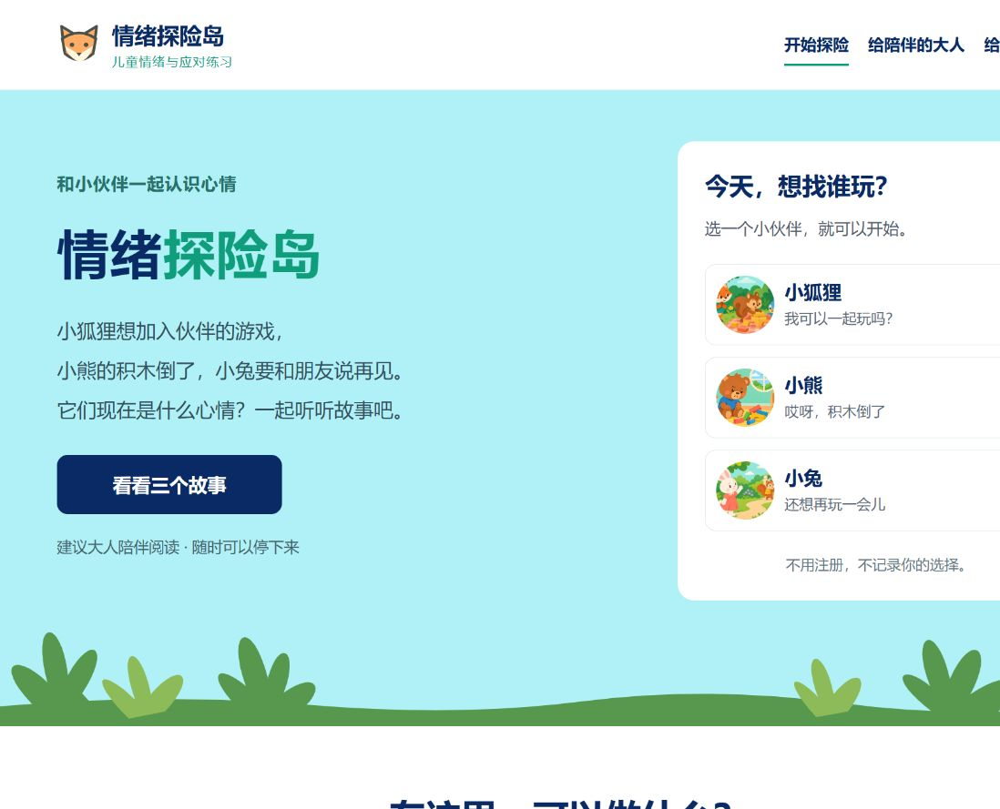

# 情绪探险岛项目说明书

> 儿童情绪与应对技能练习网页

| 项目 | 内容 |
| --- | --- |
| 中文名称 | 情绪探险岛 |
| 英文名称 | Emotion Island |
| 软件版本 | v0.1.0 |
| 文档日期 | 2026 年 11 月 11 日 |
| 当前状态 | 已部署 GitHub Pages，完成基础功能与响应式检查 |
| 在线体验 | [打开情绪探险岛](https://maoyf-dev.github.io/emotion-island/) |
| 源码仓库 | [mAoyf-dev/emotion-island](https://github.com/mAoyf-dev/emotion-island) |
| 开源许可 | MIT，详见仓库 LICENSE |

## 一、项目概述

情绪探险岛是一款以动物故事为载体的儿童情绪教育网页。儿童可以在成人陪伴下，观察角色的处境，辨认可能的感受与身体反应，了解事件和猜测的区别，再尝试选择一种应对方式。

项目从日常生活中的三个小困难切入：想加入同伴的游戏、努力搭好的积木倒下，以及和朋友结束一天的玩耍。通过图片、短句、选择和反馈，将抽象的情绪话题转化为具体的亲子交流。

当前版本定位为**心理教育与辅助练习原型**。它不提供诊断、心理测评、心理咨询或临床治疗；已有心理学方法的研究结果，不能直接作为本项目疗效的证明。



*图：2026 年 11 月 11 日从 GitHub Pages 线上站点记录的首页。*

## 二、目标用户与使用场景

### 2.1 目标用户

- **儿童：** 暂以 6—10 岁为设计目标。年龄范围尚未经儿童适龄性研究验证，应结合阅读、语言和理解能力使用。
- **陪伴者：** 家长、其他照护者，以及帮助儿童阅读和讨论的成人。
- **内容审核者：** 具有儿童心理服务或发展心理学背景的专业人员，可依据公开文案和理论记录提出修改建议。

### 2.2 使用场景

当前优先服务于家庭中的共同阅读和情绪交流。学校心理教育活动可将其作为待审核的讨论素材，具体组织方式、适用对象及效果需要另外评估。专业人员也可将其作为情境讨论素材，但网页本身不能代替专业评估与干预。

页面没有配音，阅读能力较弱的儿童需要成人读出故事和选项。不要求孩子独立完成，也不以完成时间或答题表现评价能力。

### 2.3 项目目标

| 目标 | 产品如何支持 | 当前不作出的承诺 |
| --- | --- | --- |
| 增加表达感受的机会 | 图片故事、情绪多选、“不知道”选项 | 不承诺改善情绪障碍 |
| 练习理解情境 | 区分已知事件与尚未证实的解释 | 不将所有困难归为“想错了” |
| 认识不同应对方式 | 行动选项及具体反馈 | 不保证一次选择就能解决困难 |
| 支持成人与儿童交流 | 陪伴提示、线下自愿练习 | 不把家长陪伴等同于心理治疗 |

## 三、心理学依据与证据边界

本项目以认知行为疗法（CBT）中的心理教育和应对练习作为主要设计参考，并借鉴尊重儿童自主表达与接纳感受的原则。结构化网页选择题不等同于儿童中心游戏治疗。

| 理论或研究方向 | 在项目中的落实 | 使用边界 |
| --- | --- | --- |
| CBT：情绪、身体反应、想法与行动相互影响 | 情绪选择、身体信号、情境解释和应对行动 | 六步是界面导览，不是固定的心理因果顺序 |
| CBT：检查解释与证据 | 小狐狸关区分“没有回答”和“他们不喜欢我” | 承认拒绝可能真实发生，不保证别人一定接纳 |
| 行为应对与问题解决 | 小熊关提供休息、求助、检查积木或结束活动 | 接纳生气，同时明确不能伤害自己或他人 |
| 情绪表达与接纳 | 小兔关允许失落和想念，提供告别及陪伴方式 | 不强求积极解释，不涉及死亡或创伤性分离治疗 |
| 发展适配与成人参与 | 短句、具体图片、成人阅读、示范与跳过 | 不仅凭年龄判断儿童是否理解 |

儿童焦虑 CBT 的系统综述支持其相较等待或不治疗的短期效果，但与常规照护及其他治疗比较仍有不确定性。相关证据针对具体干预方案与研究人群，不能推导出本网页具有相同效果。[Cochrane 综述](https://www.cochrane.org/evidence/CD013162_cognitive-behavioural-therapy-anxiety-children-and-young-people)

NICE 指南要求儿童干预考虑认知与情绪成熟度，并考虑照护者参与；完整的临床 CBT 还涉及专业支持、技能演练等内容。[NICE CG159](https://www.nice.org.uk/guidance/cg159/chapter/recommendations)

游戏治疗的专业定义包括理论模型、受训治疗师与治疗关系。本项目仅借鉴相关设计原则，不宣称提供游戏治疗。[APT 定义](https://www.a4pt.org/resource/resmgr/credentials/terms.pdf)

数字 CBT 的研究与指南也需要针对具体产品及支持条件理解，不能视为对本项目的认可。[NICE HTG660](https://www.nice.org.uk/guidance/htg660)

完整定向检索、证据限制及内容修改意见见[文献与内容审核](content-evidence-review.md)。这份记录由 AI 协助整理，不是持证专业人员签署的临床审核。

## 四、产品组成与故事设计

### 4.1 页面组成

| 页面 | 地址片段 | 主要功能 |
| --- | --- | --- |
| 首页 | `#home` | 项目介绍、快捷故事入口、三个故事与陪伴入口 |
| 小狐狸故事 | `#story/fox` | 同伴交往与不确定情境练习 |
| 小熊故事 | `#story/bear` | 挫折、生气与安全应对练习 |
| 小兔故事 | `#story/rabbit` | 日常分别与失落表达练习 |
| 家长陪伴指南 | `#parents` | 阅读、倾听、示范、安全边界和停止建议 |
| 理论说明 | `#theory` | 理论来源、设计机制与未验证范围 |
| 使用与隐私说明 | `#about` | 使用方式、数据处理及产品边界 |

### 4.2 三个故事

**故事一：我可以一起玩吗？**

小狐狸走近正在搭桥的伙伴，希望加入游戏，但还没有得到回答。儿童练习辨认角色的可能感受，并了解“还没回答”与“不喜欢我”并非同一个结论。行动选项包括询问一次、请熟悉的伙伴陪同，或选择其他活动。反馈承认被拒绝时可能失望，成人提示明确指出反复嘲笑、威胁或欺负需要现实保护。

**故事二：哎呀，积木倒了。**

小熊搭了很久的塔突然倒下。儿童可以讨论生气和失望，了解放下积木、休息、求助或暂停活动等方式。本关不要求儿童把失败想成好事，也不强迫重新搭建。

**故事三：还想再玩一会儿。**

朋友要回家，小兔还想继续玩。儿童可以讨论难过与想念，了解说再见、画下喜欢的片段、请求成人陪伴或商量下次联系等方式。故事限定为日常玩耍结束，不保证很快重逢，也不提供哀伤治疗。

### 4.3 每关的六步导览

| 步骤 | 儿童看到的内容 | 交互方式 |
| --- | --- | --- |
| 1. 听故事 | 插图、角色和事件 | 阅读后进入练习，也可以退出 |
| 2. 猜心情 | 开心、紧张、难过、生气、失望、不知道 | 多选；“不知道”与具体感受互斥；可跳过 |
| 3. 身体感觉 | 心跳、肚子、握拳、想哭等示例 | 多选；可选没有这些感觉、不知道或跳过 |
| 4. 想一想 | 脑中的话、已知事件和未知信息 | 查看解释，或表示不确定；可跳过 |
| 5. 选办法 | 三个具体行动及其反馈 | 一次查看一个行动的反馈；可换选或跳过 |
| 6. 再见啦 | 本次选择、线下小练习和成人提示 | 回到首页，或清空本关后重新开始 |

### 4.4 交互规则

- 不给情绪打分，不设置排名、连续打卡或完成惩罚。
- 返回上一步保留本关选择；跳过某一步会清除该步原有答案。
- 回顾页对未选择的内容明确标注，不补造儿童的感受。
- 退出、刷新、进入其他页面或切换故事会清除本次选择。
- 儿童可以停止，不需要先平静下来，也不需要完成全部练习。
- 角色表情提供线索，不用于判断儿童本人是否存在心理问题。

## 五、视觉与无障碍设计

页面样式参考了 [Khan Academy Kids Camp](https://www.khanacademy.org/kids/camp) 的布局、配色与留白：白色导航、浅青色首屏、深蓝主按钮、白色入口面板，以及浅蓝背景上的两列大插图。项目没有复制其品牌标识、角色、表单或原始图片。

三张故事插图使用内置图像工具生成，并保存在项目内，分别表现加入同伴、积木倒下和挥手告别。SVG 用于情绪小脸及装饰植物。来源与提示词见[素材记录](../assets/README.md)。

故事正文在当前桌面布局中为 24px，在手机布局中为 22px；情绪选项在本次检查的屏幕宽度下为 21—22px。页面支持键盘操作、可见焦点及减少动态偏好，不自动播放声音，不仅依赖颜色表示选中状态。

这些措施不代表已完成完整无障碍认证，实际读屏体验与儿童使用体验仍需继续验证。

## 六、技术实现与文件结构

### 6.1 技术方案

| 层次 | 实现 |
| --- | --- |
| 页面结构 | HTML5 |
| 布局与样式 | CSS Grid、Flexbox、媒体查询 |
| 交互逻辑 | 原生 JavaScript、ES modules |
| 内容组织 | JavaScript 故事对象，三个关卡共用状态逻辑 |
| 页面切换 | URL Hash 路由 |
| 数据保存 | 当前页面内存中的临时状态 |
| 内容素材 | 项目内 PNG 与 SVG |
| 自动检查 | Node.js 原生测试与语法检查 |
| 网页托管 | GitHub Pages |
| 发布流程 | GitHub Actions |

产品运行不依赖后端服务、数据库或第三方 JavaScript 框架。`package.json` 用于版本和检查命令，不需要安装运行时依赖。可选浏览器回归脚本另外需要已有的 Playwright 和 Chrome。

### 6.2 文件职责

```text
emotion-island/
├── index.html                  页面入口、导航与页脚
├── app.js                      路由、页面呈现与点击事件
├── game.js                     故事内容、选择与步骤状态
├── art.js                      图片呈现、表情与植物 SVG
├── styles.css                  布局、配色、大字和手机适配
├── favicon.svg                 网站图标
├── assets/
│   ├── stories/                fox.png、bear.png、rabbit.png
│   └── README.md               素材与提示词记录
├── tests/
│   ├── game.test.mjs           内容、图片和状态逻辑测试
│   └── browser-check.mjs       可选浏览器回归脚本
├── docs/
│   ├── 项目说明书.md            本文档
│   ├── content-evidence-review.md
│   └── images/线上首页.jpg       上线检查截图
├── .github/workflows/pages.yml 自动检查和网页部署
├── README.md                   开发与发布入口说明
├── package.json                版本及检查命令
└── LICENSE                     MIT 许可
```

## 七、隐私、安全与使用边界

### 7.1 数据处理

应用没有账号、统计脚本、数据提交接口或云端进度保存，不使用浏览器持久存储记录儿童的选择。选择只存在于当前页面内存中，不应将其描述为“绝对不会产生任何数据”：GitHub 等托管平台可能保留普通访问日志，外部研究链接也有各自的隐私政策。

### 7.2 内容安全

- 不要求填写姓名、诊断、家庭事件或真实创伤经历。
- 不根据颜色、作品、身体反应或点击选择进行诊断。
- 不包含自动暴露任务、开放式 AI 咨询或强制情绪改变任务。
- 遇到欺负与威胁时强调成人保护，不把责任归给儿童的想法。
- 可选的休息与自然呼吸提示不是治疗处方，也不是通关条件。
- 困扰持续影响生活时建议寻求专业评估；有即时危险时优先获得现实中的保护与紧急帮助。

### 7.3 当前未完成的专业工作

本项目尚未完成有资质的儿童心理专业人员逐句审核、儿童可用性试用、中文家庭环境中的适用性研究或临床效果验证。不能使用“专业审核通过”“治疗有效”“预防心理疾病”等宣传表述。

## 八、运行、发布与日常维护

### 8.1 本地预览

在项目目录启动 Python 静态服务器：

```powershell
cd "D:\vs project\儿童心理"
python -m http.server 4173 --bind 127.0.0.1
```

访问 `http://127.0.0.1:4173/`。由于页面使用 ES modules，应通过 HTTP 预览，而不是直接双击 HTML 文件。

### 8.2 本地检查

安装 Node.js 24 或更高版本后运行：

```powershell
npm test
npm run check
```

若本机全局 npm 命令异常，可使用 Node 安装目录中的 npm，或直接运行 `node --test tests/game.test.mjs`。

### 8.3 已上线的发布方式

仓库默认分支为 `main`，GitHub Pages 发布来源设置为 GitHub Actions。工作流先执行测试和语法检查，将网页文件及 `assets` 目录打包，然后部署到 Pages。项目文档和测试源码不进入该网页发布产物。

修改完成后可执行：

```powershell
git add .
git commit -m "更新情绪探险岛"
git push
```

随后查看仓库 Actions 中 `Check and deploy static site` 的执行结果，再访问线上地址确认。只有新增提交推送成功并部署完成，线上站点才会更新；本地文件保存不等于线上更新。

### 8.4 内容维护建议

修改故事时，优先在 `game.js` 中维护情境、选项和反馈，并同步检查理论说明。新增故事不仅要补数据和图片，也要调整首页布局、相关介绍与测试。涉及理论解释、安全边界或适用人群的内容，应再次进行专业审核。

插图替换后需核查画面与文字是否一致、不同屏幕裁切是否遮挡角色，以及素材目录是否进入发布产物。

## 九、上线检查记录

**检查日期：2026 年 11 月 11 日。** 本节记录浏览器对公开站点的实际操作，以及本地代码检查结果；不包含后台配置审计或疗效评价。

| 检查项 | 本次结果 |
| --- | --- |
| 公开站点可访问 | 通过，首页为当前浅青与深蓝样式 |
| 本地插图的线上路径 | 通过，三个 PNG 均加载成功 |
| 三个故事从入口到回顾 | 通过 |
| 情绪多选与“不知道”互斥 | 通过 |
| 返回保留、跳过清除、重新开始清空 | 通过 |
| 行动选项反馈 | 三个故事的首项反馈通过检查；未逐项重测全部文案 |
| 故事地址刷新 | 通过，仍可打开故事并从头开始 |
| 家长、理论、使用与隐私页 | 通过，均能打开 |
| 1440px、390px、320px 首页布局 | 通过，未观察到横向溢出 |
| 上述宽度下的小狐狸情绪页 | 通过，文字为 21—22px，未观察到横向溢出 |
| 已捕获的浏览器错误日志 | 未发现错误 |
| 本地 Node 自动测试 | 5 项通过 |
| 本地 JavaScript 语法检查 | 通过 |

本次未覆盖 Safari、Firefox、低速网络、真实移动设备、完整读屏体验或儿童实测。三个 PNG 总量约 5.6MB，弱网首次加载表现尚未测量，后续可评估图片压缩与延迟加载。

**本次结论：** 公开站点已正确提供当前版本，抽查的页面、主要交互与响应式布局工作正常；这不代表所有浏览器、所有网络环境或临床使用场景均已验证。

## 十、后续改进顺序

1. **专业内容审核：** 对每个故事、每个选项、全部反馈及家长提示进行逐句审阅，记录版本和修改意见。
2. **儿童可用性试用：** 在监护人同意与儿童自愿参与的前提下，观察理解困难、阅读负担、操作误解和不适反应。
3. **访问与无障碍优化：** 测试真实手机和不同浏览器，评估图片加载、键盘与读屏体验，再决定是否增加朗读。
4. **学习迁移评价：** 用新的情境观察儿童能否解释或演练技能，将学习表现与满意度、完成率分开记录。
5. **再扩充内容：** 在前述检查完成后考虑新故事。任何治疗或预防效果宣称都需要相应研究证据，不能仅由功能测试或小规模试用推出。

## 十一、相关文档

- [项目 README](../README.md)
- [文献与内容审核](content-evidence-review.md)
- [首版设计](superpowers/specs/2026-11-11-emotion-island-design.md)
- [插图及提示词记录](../assets/README.md)
- [MIT 许可](../LICENSE)
